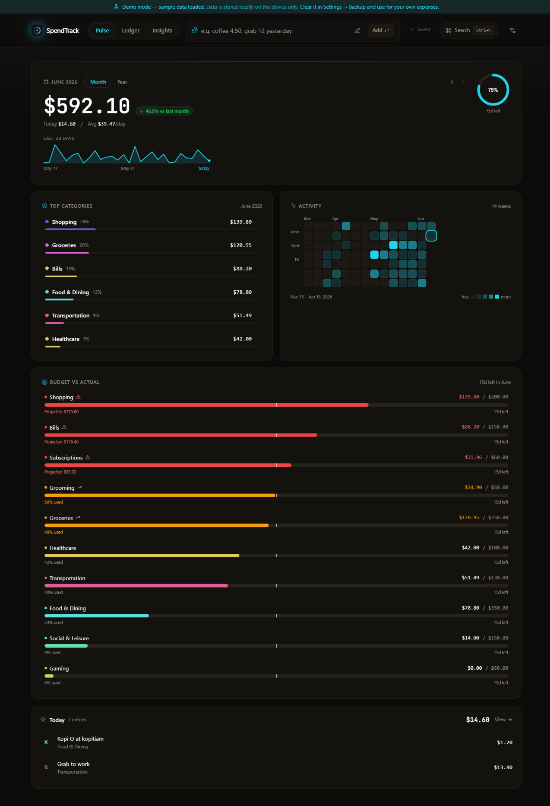
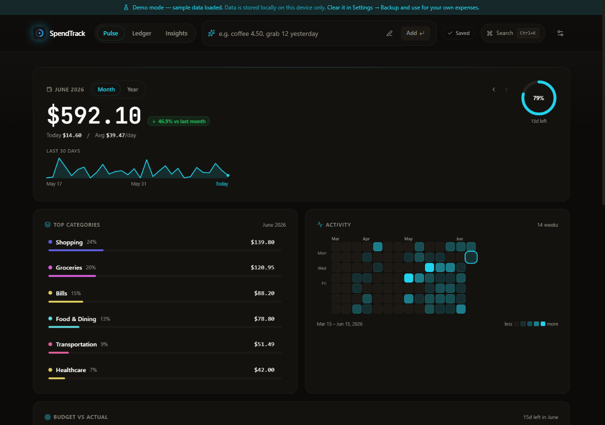
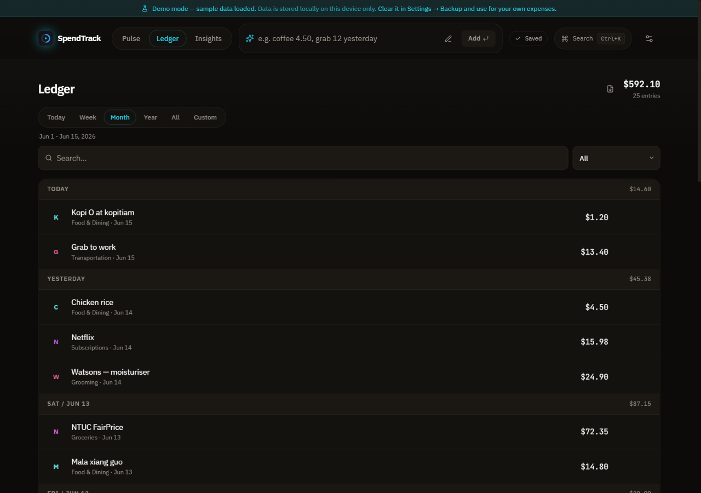
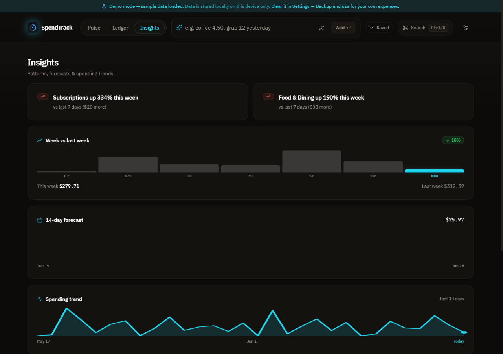

<p align="center">
  
</p>

<h1 align="center">SpendTrack</h1>

<p align="center">
  <strong>Know where your money goes — without the noise.</strong><br/>
  A fast, local-first spending tracker with smart categorisation, real-time budgets, and optional cross-device sync.
</p>

<p align="center">
  
  
  
  
  
  
  
  
</p>

<p align="center">
  <a href="https://spendtrack-demo.vercel.app"><strong>▶ Try the demo</strong></a>
  &nbsp;·&nbsp;
  <a href="#highlights">Highlights</a>
  &nbsp;·&nbsp;
  <a href="#quick-start">Quick start</a>
  &nbsp;·&nbsp;
  <a href="#architecture">Architecture</a>
  &nbsp;·&nbsp;
  <a href="#cross-device-sync">Sync</a>
</p>

<br/>

<p align="center">
  
</p>

---

## Why SpendTrack

Most personal-finance apps are built around syncing, subscriptions, and dashboards you open once and forget. SpendTrack is built for one thing: **making it effortless to log an expense and instantly see where your money is going.**

- **Offline-first.** Your data lives on your device, in your browser — not on a server. No account, no telemetry, no cloud (until _you_ opt in).
- **Friction-free entry.** Type `coffee 4.50 yesterday` and it's in. The smart parser infers item, amount, date, and category from one line.
- **Real-time pacing.** A live month-pace ring tells you whether you're on track without opening a spreadsheet.
- **Yours to theme.** Light, Dark, and System themes — a warm, soft palette that's AA-clean in both. Pick from 8 currencies.
- **Optional cross-device sync.** A single UUID code pairs your phone and laptop — no accounts, no passwords, paste once and you're done.
- **Production-grade.** Strict TypeScript, a passing Vitest suite, sub-100 KB gzipped initial JS, fully PWA-installable.

### Design choices

- **Why offline-first?** Your finances are private. The default should be no servers, no accounts, no tracking. Sync is opt-in and runs against _your own_ Supabase project.
- **Why Supabase?** It's free for personal use, the JS SDK is small enough to lazy-load, and Postgres + Realtime gives instant cross-device updates without writing a backend.
- **Why a PWA, not a native app?** Same code on every device, install in one tap, no app-store gatekeepers, full offline support via service worker.

---

## Highlights

|                       |                                                                                                                              |
| --------------------- | ---------------------------------------------------------------------------------------------------------------------------- |
| **Smart entry**       | Natural-language parser → category, amount, date inferred from one line                                                      |
| **Pulse dashboard**   | Month/year totals, daily-pace ring, sparkline trend, category mix, 14-week activity heatmap                                  |
| **Ledger**            | Search, filter, edit, undo. Multi-criteria filters live in the URL so views are bookmarkable. List virtualizes past 150 rows |
| **Insights**          | Recurring-charge detection, 14-day forecast, week-over-week comparisons, anomaly callouts                                    |
| **Budgets**           | Per-category monthly caps with side-by-side actual-vs-budget bars                                                            |
| **Theming**           | Light / Dark / System — a warm, soft palette (AA-clean in both themes). 8 selectable currencies                              |
| **Cross-device sync** | Optional. UUID code pairs devices. Per-expense Last-Write-Wins merge. Tombstone-safe deletes. Realtime push.                 |
| **PWA**               | Installable on iOS & Android. Works fully offline. CSS-keyframe route transitions (no React-state animations that can stall) |
| **Privacy**           | No account. No analytics. No tracking. Data is local unless you generate a sync code                                         |

---

## Try it in 30 seconds

|                      | Where                                                            | Notes                                                              |
| -------------------- | ---------------------------------------------------------------- | ------------------------------------------------------------------ |
| **▶ Demo**           | [spendtrack-demo.vercel.app](https://spendtrack-demo.vercel.app) | Pre-loaded with realistic data — your changes stay on your device  |
| **📱 Install**       | Open the demo on your phone → Share → **Add to Home Screen**     | Behaves exactly like a native app, fully offline                   |
| **🧹 Make it yours** | Settings → Backup → **Clear sample data**                        | Removes the sample entries for good; they never come back          |
| **💻 Self-host**     | [Quick start ↓](#quick-start)                                    | Clone & run in under a minute — full ownership, zero third-parties |

---

## Screenshots

<table>
<tr>
  <td width="33%" align="center"><b>Pulse</b><br/><sub>Live pace ring · sparkline · heatmap · budgets</sub></td>
  <td width="33%" align="center"><b>Ledger</b><br/><sub>Searchable history · URL-driven filters · undo</sub></td>
  <td width="33%" align="center"><b>Insights</b><br/><sub>Recurring detection · 14-day forecast · trends</sub></td>
</tr>
<tr>
  <td></td>
  <td></td>
  <td></td>
</tr>
</table>

---

## Quick start

**Requirements:** Node.js 20+, npm

```bash
git clone https://github.com/ShadeNKB/spending-budgeting-tracker.git
cd spending-budgeting-tracker
npm ci
npm run dev
```

Open [http://localhost:5173](http://localhost:5173). No environment variables needed.

To enable cross-device sync (optional):

```bash
cp .env.example .env.local
# fill VITE_SUPABASE_URL and VITE_SUPABASE_ANON_KEY,
# then run supabase/migrations/001_sync.sql in your Supabase SQL editor.
```

See [`.env.example`](.env.example) for the 3-step setup.

---

## Scripts

```bash
npm run dev        # Local dev server with HMR
npm run build      # Production build
npm run preview    # Preview production build locally
npm run lint       # ESLint
npm run typecheck  # tsc --noEmit (strict)
npm run test:run   # Vitest, single run
npm run verify     # every gate: typecheck, lint, format, tests, build, bundle size, smoke
npm run e2e        # Playwright (Chromium + iPhone WebKit), incl. the accessibility gate
npm run e2e:data   # data-engine release gate: this build beside 0.9.2 on a fake relay
```

---

## Architecture

### Local-first by default

On load, the data engine boots from `localStorage`. Every action — adding an expense, changing a budget, renaming a category — is validated and written through at once: one digest-checked envelope (`st5:db`) per change, a rollback copy in the 0.9.x keys, snapshots before destructive changes, and anything unreadable set aside (never deleted). Two tabs merge rather than overwrite each other. There is no server in the hot path; latency is zero.

```
┌──────────────────────────────────────────────────────────┐
│  React app (Pulse / Ledger / Insights / Settings)        │
│       │                                                  │
│       ▼                                                  │
│  Zustand stores (expense facade, sync, ui)               │
│       │                                                  │
│       ▼                                                  │
│  data engine (lazy chunk): src/data/core + src/data/local│
│       │   validated ops, merge, undo, migration, journal │
│       ▼                                                  │
│  localStorage: st5:db envelope + v4 rollback mirror      │
│       │                                                  │
│       ▼                                                  │
│  syncEngine.ts  ⇆  Supabase (optional relay)             │
└──────────────────────────────────────────────────────────┘
```

### Cross-device sync (opt-in)

When sync is configured (Supabase env vars + a UUID sync code paired between devices):

- **Each device keeps a full copy.** Cloud is a relay between them.
- **Per-field merge** (v5 wire, additive over the v4 payload so 0.9.2 devices still read it): each field of an entry, each budget, item pick and category rename converges on its newest change; deletions are dated, so Undo and Restore travel too.
- **Pushes only when the relay lacks something** (digest compare, echo filter): two devices go quiet after one exchange, and beside a 0.9.2 device there is no ping-pong.
- **1.5 s quiet push** on local changes (5 s at most); **Supabase Realtime subscription** for instant pull on remote changes; a pending outbox survives reloads.
- **Mass-removal guard**: a large removal from another device is snapshotted first and offered back with Undo.
- **Single in-flight cycle** (with a cross-tab lock) prevents push-during-pull races.
- **Exponential backoff** on push failure (2 s × 2ⁿ, cap 60 s); resets on success.
- **Realtime auto-reconnect** on `CLOSED / CHANNEL_ERROR / TIMED_OUT`.
- **Payload guard** pauses sync before a push passes 1 MB (Supabase row limit), with a clear message.
- **No accounts.** The 122-bit UUID is the practical security boundary for a personal Supabase relay. Because the anon key is public and this table grants broad anon access, do not treat this model as hardened multi-user SaaS security.

See [`src/data/core`](src/data/core) for the merge logic and [`src/stores/syncEngine.ts`](src/stores/syncEngine.ts) for the cycle.

### Performance

|                               |                                                         |
| ----------------------------- | ------------------------------------------------------- |
| Main bundle (gzip)            | **81 KB**                                               |
| Total initial download (gzip) | ~190 KB                                                 |
| Settings drawer               | code-split (lazy)                                       |
| Supabase JS SDK               | lazy `import()` — only loaded when sync is configured   |
| Hydration                     | deferred to `useEffect` to keep first paint unblocked   |
| Route transitions             | CSS keyframe (no React-state animations that can stall) |

### Stability

- Strict TypeScript, no `any`
- Passing Vitest unit suite across core parsing, analytics, storage, and sync logic
- Ledger virtualizes beyond 150 rows (`@tanstack/react-virtual`) — scales to thousands of entries without dropping frames
- CI smoke test boots `vite preview` and asserts all 4 routes + service worker + manifest
- Storage quota errors are caught and shown as "Not saved: storage is full" (never silent data loss); a damaged key or row is set aside under Needs attention, never deleted
- JSON import: 8 MB file cap, every row validated, a preview with exact counts, Restore (never deletes) or a typed Replace, 30 s Undo
- Rapid-navigation stress-tested across mobile / desktop / production / 4× CPU-throttled — 290 iterations, 0 blank renders

---

## Sync your phone & laptop

Sync is **optional**. Skip this section if you only use one device — your data is already saved locally and you can export JSON backups anytime.

If you do want phone ↔ laptop sync, here's the full flow:

### 0 · One-time setup (do this once, on any device)

You need your own free Supabase project. This is what stores the synced data — no third-party sees it. Plan ~5 minutes.

1. Sign up at [supabase.com](https://supabase.com) and create a project.
2. In the project's **SQL Editor**, run [`supabase/migrations/001_sync.sql`](supabase/migrations/001_sync.sql), then [`002_sync_indexes.sql`](supabase/migrations/002_sync_indexes.sql) (index + retention helper) and [`003_harden_prune_search_path.sql`](supabase/migrations/003_harden_prune_search_path.sql) (pins `search_path` on the prune function). The helper only creates a manual pruning function; schedule it yourself if you want automatic 90-day cleanup.
3. From **Project Settings → API**, copy the **Project URL** and the **anon public** key.
4. Add them as env vars on Vercel (or in `.env.local` if you self-host):
   ```bash
   VITE_SUPABASE_URL=https://your-project.supabase.co
   VITE_SUPABASE_ANON_KEY=eyJhbGc...
   ```
5. Redeploy. The app now offers sync in Settings.

### 1 · Generate a sync code (Device A — typically your laptop)

Settings → **Sync** → **Generate sync code for this device**. Copy the UUID that appears.

### 2 · Connect Device B (your phone)

Open the same site on your phone. Settings → **Sync** → paste the code into **Connect**. Within ~3 seconds your laptop's data appears on your phone.

### 3 · Use either device

Add an expense on Device A. It appears on Device B within a second via Supabase Realtime. Same in the other direction. Delete on either, it's deleted everywhere. Each device works fully offline; pending changes sync the moment connection is restored.

### 4 · Add a third device — repeat step 2

Tablet, work browser, partner's laptop — paste the same UUID into Settings → Sync → Connect. There's no device limit.

> **Treat the sync code like a password.** Anyone with it can read & write your synced data. Don't share it in chats or screenshots. If you ever lose or leak it, generate a new one — old buckets auto-prune after 90 days.

### How sync actually works

```
Device A                                    Device B
  │                                            │
  │  add expense "Coffee 4.50"                 │
  ├──────────► localStorage (instant)          │
  │                                            │
  │  1.5 s quiet ──► Supabase ──── push        │
  │                       │                    │
  │                       │   Realtime         │
  │                       └──────────► pull ───┤
  │                                            │
  │                                  add expense "Lunch 12"
  │                                            ├──► localStorage
  │                                            │
  │  Realtime ◄──── push ◄──── Supabase ◄──── 1.5 s quiet
  ├──────────► merge + apply                   │
  │  (newest change wins, per field)           │
```

- **Each device keeps a full copy.** Cloud is a relay between them.
- **Per-field merge**: an amount edited on the phone and a category changed on the laptop both survive; budgets, item picks, renames and the currency merge the same way, so a stale device cannot revert a newer change.
- **Dated deletions**: deleted entries stay deleted, and an Undo or a Restore brings them back on every device.
- **Single in-flight cycle** prevents push-during-pull races.
- **Exponential backoff** on push failure (2 s × 2ⁿ, cap 60 s).
- **Realtime auto-reconnect** on `CLOSED / CHANNEL_ERROR / TIMED_OUT`.
- **Payload guard** pauses sync before a push passes 1 MB (Supabase row limit).
- **No accounts.** The 122-bit UUID is the practical security boundary for a personal Supabase relay, not a hardened multi-user SaaS boundary.

Full architecture: [`docs/USER_GUIDE.md`](docs/USER_GUIDE.md) · [`src/services/syncService.ts`](src/services/syncService.ts).

---

## FAQ

<details>
<summary><b>Do I need an account?</b></summary>
<br/>
No. SpendTrack has no built-in account system. Sync is opt-in and runs against <i>your own</i> Supabase project — you own the data, end-to-end.
</details>

<details>
<summary><b>Where is my data stored?</b></summary>
<br/>
By default: in your browser's <code>localStorage</code> on the device you're using. Nothing leaves the device. If you opt into sync, an encrypted-in-transit copy is also stored in your Supabase project's <code>sync_buckets</code> table — under a row keyed by your UUID sync code.
</details>

<details>
<summary><b>What happens if I edit on two devices at the same time?</b></summary>
<br/>
Each expense has an <code>updatedAt</code> timestamp. The newer edit wins (last-write-wins) per expense. Deletes propagate via a tombstone list, so a deleted expense never resurrects.
</details>

<details>
<summary><b>What if I'm offline?</b></summary>
<br/>
The app works fully offline — every action writes to <code>localStorage</code> immediately. Cloud sync waits patiently. The moment you're online again, queued changes push and any remote changes merge in.
</details>

<details>
<summary><b>What if I lose my sync code?</b></summary>
<br/>
Generate a new one in Settings → Sync. The old bucket stays in your Supabase project for 90 days then auto-prunes (if you scheduled <code>prune_stale_sync_buckets()</code>; otherwise it persists harmlessly).
</details>

<details>
<summary><b>Can I install it on my phone like a real app?</b></summary>
<br/>
Yes — it's a PWA. <b>iOS:</b> open the site in Safari → Share → <i>Add to Home Screen</i>. <b>Android:</b> Chrome menu → <i>Install app</i>. The installed version runs fullscreen, has its own home-screen icon, and works offline exactly like a native app.
</details>

<details>
<summary><b>Does this work on multiple platforms? (iOS / Android / desktop)</b></summary>
<br/>
Yes. One codebase, every platform. The PWA is installable from any modern browser; sync works the same across all of them.
</details>

<details>
<summary><b>How do I move my data to a new browser without sync?</b></summary>
<br/>
Settings → Backup → <b>Download JSON backup</b>. On the new browser, Settings → Backup → <b>Import JSON backup</b>, check the preview, then <b>Restore</b>. Categories, budgets, item picks and expenses transfer in full, and Restore never deletes anything already there.
</details>

<details>
<summary><b>Can I switch themes or change the currency?</b></summary>
<br/>
Yes. Settings → <b>Appearance</b> offers <b>Light</b>, <b>Dark</b>, and <b>System</b> (follows your OS). The palette is warm and soft, and stays WCAG-AA legible in both themes. Currency is a separate setting with 8 options (USD, SGD, EUR, GBP, JPY, AUD, CAD, and more) — amounts reformat instantly everywhere.
</details>

<details>
<summary><b>Is my data encrypted?</b></summary>
<br/>
In transit (HTTPS to Supabase): yes. At rest in <code>localStorage</code> or Supabase: no, it's plain JSON. Treat your sync code as a password — that's the security boundary.
</details>

---

## Troubleshooting

<details>
<summary><b>"Sync failed" — what now?</b></summary>
<br/>
The pill in the top bar is tappable when sync fails. Tap it to retry. Local data is always safe — the failure only means the cloud copy is behind. The app also retries automatically with exponential backoff.
</details>

<details>
<summary><b>I generated a sync code but my phone says "Could not reach sync server"</b></summary>
<br/>

1. Confirm both devices have <code>VITE_SUPABASE_URL</code> and <code>VITE_SUPABASE_ANON_KEY</code> set (env vars must match on both deployments).
2. Confirm <code>supabase/migrations/001_sync.sql</code> ran without errors. <i>Important:</i> the migration intentionally disables RLS for this simple personal relay model; enabling RLS without replacing the sync access layer will block anon writes.
3. Reload both devices. The Supabase JS SDK is lazy-loaded only when sync is configured, so an offline cold start looks like silent failure — a refresh re-triggers the load.
</details>

<details>
<summary><b>"Not saved: storage is full · Download a backup"</b></summary>
<br/>
Browser <code>localStorage</code> caps around 5–10 MB. SpendTrack catches the quota error, never shows "Saved" for a change it could not keep, and retries. Download a JSON backup first; then delete entries you no longer need in the Ledger, or move to a different browser profile and import the backup there.
</details>

<details>
<summary><b>The app feels stale after I deploy a new version</b></summary>
<br/>
Service workers occasionally serve a cached shell. Hard reload (Ctrl+Shift+R / Cmd+Shift+R), or close and reopen the installed PWA. The new SW activates immediately on next visit thanks to <code>skipWaiting</code>.
</details>

<details>
<summary><b>Pulse / Insights flash blank momentarily?</b></summary>
<br/>
This was a real bug fixed in v0.5.0 (PR #9). If you see it on the deployed site, you may be on a cached old SW — hard reload to pick up the fix.
</details>

---

## Tech stack

| Layer     | Tools                                                                        |
| --------- | ---------------------------------------------------------------------------- |
| Framework | React 19, TypeScript (strict), Vite                                          |
| Styling   | Tailwind CSS, CSS custom properties (warm, soft palette · Light/Dark/System) |
| State     | Zustand + `subscribeWithSelector`                                            |
| Routing   | React Router v7                                                              |
| Lists     | @tanstack/react-virtual (ledger windowing past 150 rows)                     |
| Animation | CSS transitions + Web Animations API (no library; springs as `linear()`)     |
| Search    | Fuse.js (smart-entry parser)                                                 |
| Dates     | date-fns                                                                     |
| Sync      | Supabase Postgres + Realtime (lazy-loaded, opt-in)                           |
| PWA       | vite-plugin-pwa, Workbox                                                     |
| Testing   | Vitest, Testing Library, curl-based preview smoke                            |
| Deploy    | Vercel                                                                       |

---

## Project structure

```
src/
  app/          Shell, routing, top/tab bar, sync status pill
  features/     pulse · ledger · insights · entry · settings
  ui/           Reusable primitives (Card, Button, Sheet, Pill, …)
  stores/       Zustand stores (expense, sync, ui)
  services/     storage layer, syncService (Supabase relay)
  lib/          analytics, format, download helpers
  utils/        parseExpense, insights, recurring, helpers
  hooks/        useToast, useHotkeys, useHaptic
public/         favicon, manifest
supabase/       sync migrations
docs/           user guide, screenshots
```

---

## Roadmap & changelog

- ✅ Cross-device sync (Supabase relay, UUID pairing, LWW merge, tombstones)
- ✅ Light / Dark / System theming + 8-currency support
- ✅ Warmer/softer visual redesign across all four surfaces (AA-clean in both themes)
- ✅ Ledger virtualization (`@tanstack/react-virtual`) — scales to thousands of rows
- ✅ Performance pass — main bundle 81 KB gzip; Supabase + Settings lazy-loaded
- ✅ Rapid-nav blank-render bug eliminated — 290 stress-test iterations, 0 blanks
- ✅ Storage quota toast + JSON import schema validation
- ✅ Production CI smoke test on every route + service worker + manifest

Full history: [`CHANGELOG.md`](CHANGELOG.md).

---

## Contributing

PRs and issues welcome. Please don't share real spending data in public issues or screenshots.

- [User guide](docs/USER_GUIDE.md)
- [Contributing](CONTRIBUTING.md)
- [Security policy](SECURITY.md)

---

## License

[MIT](LICENSE) — built by [ShadeNKB](https://github.com/ShadeNKB)
