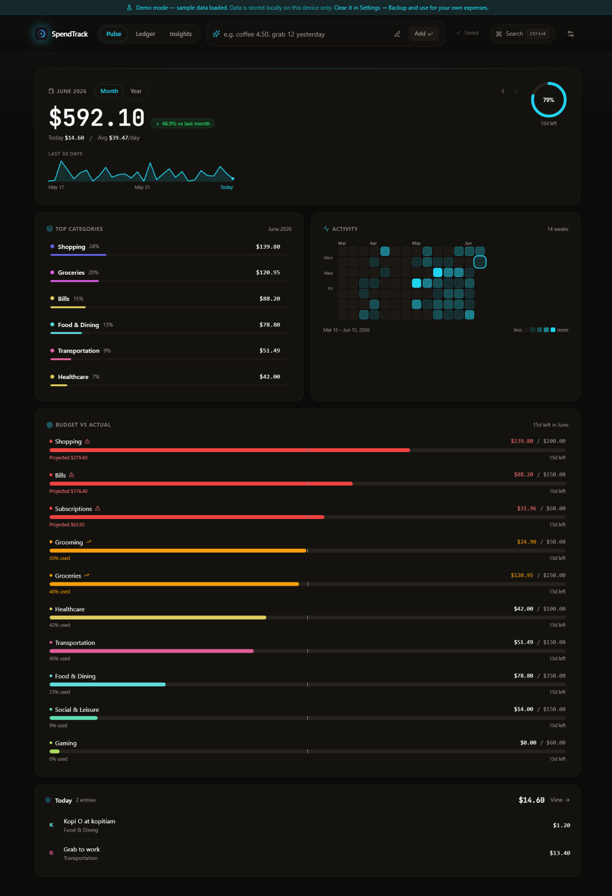
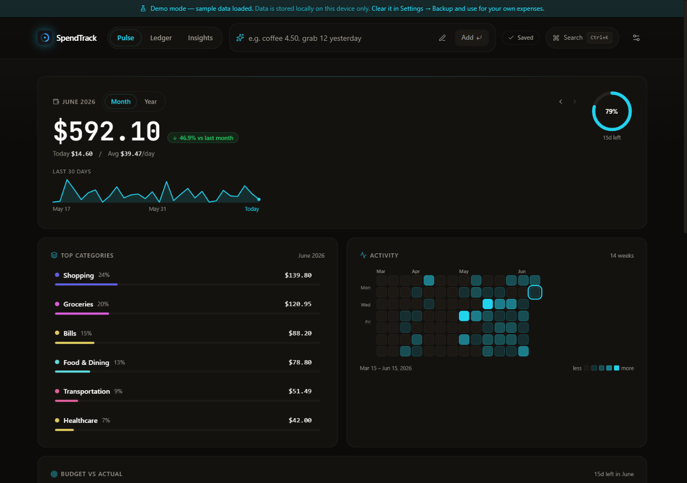
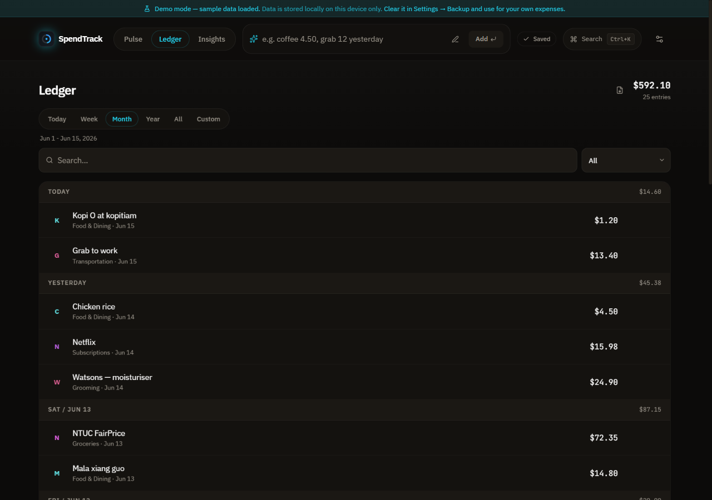
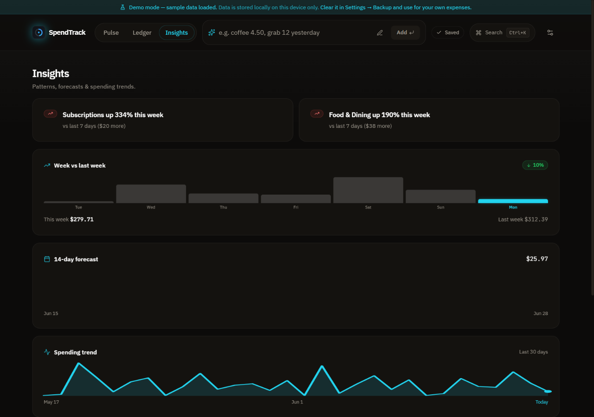

<p align="center">
  
</p>

<h1 align="center">SpendTrack</h1>

<p align="center">
  <strong>Know where your money goes — without the noise.</strong><br/>
  A fast, local-first spending tracker with smart categorisation, real-time budgets, and optional cross-device sync.
</p>

<p align="center">
  
  
  
  
  
  
</p>

<p align="center">
  <a href="https://spendtrack-demo.vercel.app"><strong>▶ Try the demo</strong></a>
  &nbsp;·&nbsp;
  <a href="#highlights">Highlights</a>
  &nbsp;·&nbsp;
  <a href="#run-your-own">Run your own</a>
  &nbsp;·&nbsp;
  <a href="#architecture">Architecture</a>
  &nbsp;·&nbsp;
  <a href="#cross-device-sync">Sync</a>
</p>

<br/>

<p align="center">
  
</p>

---

## Run your own

SpendTrack is yours to run: clone it, `npm ci`, `npm run dev`, and everything but sync works with no server and no settings. Deploy the `dist/` folder to any static host. For sync between your devices, set up a free Supabase project of your own: run six SQL files in order, set three build settings, redeploy, then Generate a code on one device and Join on the other. Every new sync is private (encrypted on the device).

**[Run your own SpendTrack →](docs/SELF_HOST.md)** (step by step, with what each step should show, the limits, and troubleshooting)

---

## Why SpendTrack

Most personal-finance apps are built around syncing, subscriptions, and dashboards you open once and forget. SpendTrack is built for one thing: **making it effortless to log an expense and instantly see where your money is going.**

- **Offline-first.** Your data lives on your device, in your browser — not on a server. No account, no telemetry, no cloud (until _you_ opt in).
- **Friction-free entry.** Type `coffee 4.50 yesterday` and it's in. The smart parser infers item, amount, date, and category from one line.
- **Real-time pacing.** A live month-pace ring tells you whether you're on track without opening a spreadsheet.
- **Yours to theme.** Light, Dark, and System themes — a warm, soft palette that's AA-clean in both. Pick from 8 currencies.
- **Optional cross-device sync.** A single sync code pairs your phone and laptop — no accounts, no passwords, paste once and you're done. Where the relay's sync functions are on, a new sync is private: encrypted on the device before anything leaves it.
- **Production-grade.** Strict TypeScript, Vitest and Playwright suites with an accessibility gate, startup size budgets checked in CI, fully PWA-installable.

### Design choices

- **Why offline-first?** Your finances are private. The default should be no servers, no accounts, no tracking. Sync is opt-in and runs against _your own_ Supabase project.
- **Why Supabase?** It's free for personal use, the JS SDK is small enough to lazy-load, and Postgres + Realtime gives instant cross-device updates without writing a backend.
- **Why a PWA, not a native app?** Same code on every device, install in one tap, no app-store gatekeepers, full offline support via service worker.

---

## Highlights

|                       |                                                                                                                                    |
| --------------------- | ---------------------------------------------------------------------------------------------------------------------------------- |
| **Smart entry**       | Natural-language parser → category, amount, date inferred from one line                                                            |
| **Pulse dashboard**   | Month/year totals, daily-pace ring, sparkline trend, category mix, 14-week activity heatmap                                        |
| **Ledger**            | Search, filter, edit, undo. Multi-criteria filters live in the URL so views are bookmarkable. List virtualizes past 150 rows       |
| **Insights**          | Recurring-charge detection, 14-day forecast, week-over-week comparisons, anomaly callouts                                          |
| **Budgets**           | Per-category monthly caps with side-by-side actual-vs-budget bars                                                                  |
| **Theming**           | Light / Dark / System — a warm, soft palette (AA-clean in both themes). 8 selectable currencies                                    |
| **Cross-device sync** | Optional. One code pairs devices. Per-field merge. Dated deletes. Realtime push. Private (encrypted) sync on the relay's functions |
| **PWA**               | Installable on iOS & Android. Works fully offline. CSS-keyframe route transitions (no React-state animations that can stall)       |
| **Privacy**           | No account. No analytics. No tracking. Data is local unless you generate a sync code                                               |

---

## Try it in 30 seconds

|                      | Where                                                            | Notes                                                              |
| -------------------- | ---------------------------------------------------------------- | ------------------------------------------------------------------ |
| **▶ Demo**           | [spendtrack-demo.vercel.app](https://spendtrack-demo.vercel.app) | Pre-loaded with realistic data — your changes stay on your device  |
| **📱 Install**       | Open the demo on your phone → Share → **Add to Home Screen**     | Behaves exactly like a native app, fully offline                   |
| **🧹 Make it yours** | Settings → Backup → **Clear sample data**                        | Removes the sample entries for good; they never come back          |
| **💻 Self-host**     | [Run your own](docs/SELF_HOST.md)                                | Clone & run in under a minute — full ownership, zero third-parties |

---

## Screenshots

<table>
<tr>
  <td width="33%" align="center"><b>Pulse</b><br/><sub>Live pace ring · sparkline · heatmap · budgets</sub></td>
  <td width="33%" align="center"><b>Ledger</b><br/><sub>Searchable history · URL-driven filters · undo</sub></td>
  <td width="33%" align="center"><b>Insights</b><br/><sub>Recurring detection · 14-day forecast · trends</sub></td>
</tr>
<tr>
  <td></td>
  <td></td>
  <td></td>
</tr>
</table>

---

## Quick start

**Requirements:** Node.js 20+, npm

```bash
git clone https://github.com/ShadeNKB/spending-budgeting-tracker.git
cd spending-budgeting-tracker
npm ci
npm run dev
```

Open [http://localhost:5173](http://localhost:5173). No environment variables needed.

To enable cross-device sync (optional), follow [`docs/SELF_HOST.md`](docs/SELF_HOST.md): it sets up your own Supabase project from empty, then:

```bash
cp .env.example .env.local
# fill VITE_SUPABASE_URL, VITE_SUPABASE_ANON_KEY and VITE_SYNC_RELAY=rpc
```

[`.env.example`](.env.example) lists every build setting.

---

## Scripts

```bash
npm run dev        # Local dev server with HMR
npm run build      # Production build
npm run preview    # Preview production build locally
npm run lint       # ESLint
npm run typecheck  # tsc --noEmit (strict)
npm run test:run   # Vitest, single run
npm run verify     # every gate: backup guard, typecheck, lint, format, tests, build, size budgets, smoke
npm run e2e        # Playwright (Chromium + iPhone WebKit), incl. the accessibility gate
npm run e2e:data   # data-engine release gate: this build beside older releases on a fake relay
```

---

## Architecture

### Local-first by default

On load, the data engine boots from `localStorage`. Every action — adding an expense, changing a budget, renaming a category — is validated and written through at once: one digest-checked envelope (`st5:db`) per change, a rollback copy in the 0.9.x keys, snapshots before destructive changes, and anything unreadable set aside (never deleted). Two tabs merge rather than overwrite each other. There is no server in the hot path; latency is zero.

```
┌──────────────────────────────────────────────────────────┐
│  React app (Pulse / Ledger / Insights / Settings)        │
│       │                                                  │
│       ▼                                                  │
│  Zustand stores (expense facade, sync, ui)               │
│       │                                                  │
│       ▼                                                  │
│  data engine (lazy chunk): src/data/core + src/data/local│
│       │   validated ops, merge, undo, migration, journal │
│       ▼                                                  │
│  localStorage: st5:db envelope + v4 rollback mirror      │
│       │                                                  │
│       ▼                                                  │
│  syncEngine.ts  ⇆  Supabase (optional relay)             │
└──────────────────────────────────────────────────────────┘
```

### Cross-device sync (opt-in)

When sync is configured (Supabase env vars + a sync code paired between devices):

- **Each device keeps a full copy.** Cloud is a relay between them.
- **Per-field merge** (v5 wire, additive over the v4 payload so 0.9.2 devices still read it): each field of an entry, each budget, item pick and category rename converges on its newest change; deletions are dated, so Undo and Restore travel too.
- **Pushes only when the relay lacks something** (digest compare, echo filter): two devices go quiet after one exchange, and beside a 0.9.2 device there is no ping-pong.
- **1.5 s quiet push** on local changes (5 s at most), and at once (with `keepalive`) when the app goes to the background; a pending outbox survives reloads and crashes.
- **Realtime on a hashed topic** (never the code itself): Broadcast between 0.11 devices plus `postgres_changes`, an echo filter and a storm breaker. Only visible tabs subscribe; while visible the app also checks every minute (every 5 minutes while live), and a check that finds the same `updated_at` downloads nothing.
- **Join never creates**: a code is validated before any request, previewed (exact counts, nothing saved), and a code with no synced copy creates nothing.
- **Device registry**: every push carries this device's entry (its version, relay mode, last seen); Settings → Sync lists the devices and says when all of them run this build.
- **Mass-removal guard**: a large removal from another device is snapshotted first and offered back with Undo.
- **Single in-flight cycle** (with a cross-tab lock) prevents push-during-pull races; compare-and-set writes (behind `VITE_SYNC_CAS=on`) stop two crossing pushes from overwriting each other.
- **Backoff** on push failure (2 s × 2ⁿ⁻¹, cap 60 s, ±20 % jitter), paused while hidden or offline; resets on success, `online` and coming back to the app.
- **Payload guard** pauses sync before a push passes 1 MB (Supabase row limit), with a clear message and a size meter from 70 %.
- **Private sync** (0.21.0, where `VITE_SYNC_RELAY=auto` or `rpc`, or `VITE_SYNC_CAS=on`): **Generate** makes an `ST5-` code; each device encrypts what it sends (AES-GCM-256, key derived from the code with HKDF-SHA256, both built into the browser), and the relay row sits under an id derived from the code, never the code. A sync made before that, or on a build without those settings, is a plain sync and is not encrypted.
- **No accounts.** The anon key is public. After the table lockdown (migration 005) it can only call the relay's three sync functions, which need a row id; on a relay without it, the table grants broad anon access and anyone with the key can read a plain sync's copy. A new project set up with [the guide](docs/SELF_HOST.md) is locked down from the start. Do not treat this model as hardened multi-user SaaS security ([`supabase/README.md`](supabase/README.md) lists its known limits).

See [`src/data/core`](src/data/core) for the merge logic and [`src/stores/syncEngine.ts`](src/stores/syncEngine.ts) for the cycle.

### Performance

|                   |                                                                                                     |
| ----------------- | --------------------------------------------------------------------------------------------------- |
| Size budgets      | `npm run size` (all JS and CSS) and `npm run size:relay` (startup) print each number and its budget |
| Data engine       | its own chunk, preloaded and started before React renders; the shell says it is loading until then  |
| Overlays          | Settings, palette, Add sheet and toasts are lazy, mounted after first paint                         |
| Sync engine + SDK | lazy `import()` — only loaded when sync is used                                                     |
| Route transitions | CSS keyframe (no React-state animations that can stall)                                             |

### Stability

- Strict TypeScript, no `any`
- Passing Vitest unit suite across core parsing, analytics, storage, and sync logic
- Ledger virtualizes beyond 150 rows (`@tanstack/react-virtual`) — scales to thousands of entries without dropping frames
- CI smoke test boots `vite preview` and asserts all 4 routes + service worker + manifest
- Storage quota errors are caught and shown as "Not saved: storage is full" (never silent data loss); a damaged key or row is set aside under Needs attention, never deleted
- JSON import: 8 MB file cap, every row validated, a preview with exact counts, Restore (never deletes) or a typed Replace, 30 s Undo
- Rapid-navigation stress-tested across mobile / desktop / production / 4× CPU-throttled — 290 iterations, 0 blank renders

---

## Sync your phone & laptop

Sync is **optional**. Skip this section if you only use one device — your data is already saved locally and you can export JSON backups anytime.

If you do want phone ↔ laptop sync, here's the full flow:

### 0 · One-time setup (do this once, on any device)

You need your own free Supabase project. This is what stores the synced data — no third-party sees it. Plan ~20 minutes. [`docs/SELF_HOST.md`](docs/SELF_HOST.md) has every step and what it should show; in short:

1. Sign up at [supabase.com](https://supabase.com) and create a project.
2. In the project's **SQL Editor**, run `001` to `006` from [`supabase/migrations`](supabase/migrations) by hand, in order, each followed by the check the guide names (never `supabase db push`). On a new project they all go in at one sitting: no waiting between them.
3. From **Project Settings**, copy the **Project URL** and the **anon public** (or publishable) key.
4. Set the build settings on your host (or in `.env.local`):
   ```bash
   VITE_SUPABASE_URL=https://your-project-ref.supabase.co
   VITE_SUPABASE_ANON_KEY=your-anon-or-publishable-key
   VITE_SYNC_RELAY=rpc
   ```
5. Redeploy. The app now offers sync in Settings.

Already syncing through a relay set up before migration 004? Upgrade it step by step with [the runbook](docs/brain/sync-runbook.md) instead.

### 1 · Generate a sync code (Device A — typically your laptop)

Settings → **Sync** → **Generate sync code for this device**. The code shows masked: tap **Copy**, or **Show** to read it. On a build with the relay's sync functions (`VITE_SYNC_RELAY=rpc` or `auto`) it is a private `ST5-` code; SpendTrack older than 0.21.0 refuses it.

### 2 · Join from Device B (your phone)

Open the same site on your phone. Settings → **Sync** → paste the code under **or join an existing one** → **Join**. SpendTrack reads the synced copy and shows what joining does ("This device: 0 entries · Synced: 120 entries · After joining: about 120 entries"); tap **Join** again and your laptop's data appears on your phone. A mistyped code says "No synced data found for this code" and creates nothing.

### 3 · Use either device

Add an expense on Device A. It appears on Device B within a second via Supabase Realtime. Same in the other direction. Delete on either, it's deleted everywhere. Each device works fully offline; pending changes sync the moment connection is restored.

### 4 · Add a third device — repeat step 2

Tablet, work browser, another browser profile — join the same code in Settings → Sync. There's no device limit, and Settings → Sync → **Devices** lists every device with its version.

> **Share the code only with your own devices.** Anyone with it can change your synced data. A private sync's relay copy is encrypted and only a device with the code can read it; a plain sync's copy is not, and on a relay without the database lockdown (migration 005) anyone with the app's public key could read it. **Disconnect** keeps the code on that device for 30 days (**Reconnect** is one tap); if you lose it, copy it from another linked device. Generating a new code starts a separate sync; old buckets are pruned after 90 days if you schedule `prune_stale_sync_buckets()`.

### How sync actually works

```
Device A                                    Device B
  │                                            │
  │  add expense "Coffee 4.50"                 │
  ├──────────► localStorage (instant)          │
  │                                            │
  │  1.5 s quiet ──► Supabase ──── push        │
  │                       │                    │
  │                       │   Realtime         │
  │                       └──────────► pull ───┤
  │                                            │
  │                                  add expense "Lunch 12"
  │                                            ├──► localStorage
  │                                            │
  │  Realtime ◄──── push ◄──── Supabase ◄──── 1.5 s quiet
  ├──────────► merge + apply                   │
  │  (newest change wins, per field)           │
```

- **Each device keeps a full copy.** Cloud is a relay between them.
- **Per-field merge**: an amount edited on the phone and a category changed on the laptop both survive; budgets, item picks, renames and the currency merge the same way, so a stale device cannot revert a newer change.
- **Dated deletions**: deleted entries stay deleted, and an Undo or a Restore brings them back on every device.
- **Single in-flight cycle** prevents push-during-pull races.
- **Backoff** on push failure (2 s → 60 s with jitter), paused in the background, and a check every minute while the app is open if Realtime is unavailable.
- **Realtime auto-reconnect** on `CLOSED / CHANNEL_ERROR / TIMED_OUT`, on a hashed topic.
- **Payload guard** pauses sync before a push passes 1 MB (Supabase row limit).
- **No accounts.** A private sync's copy is ciphertext. For a plain sync on a relay without migration 005, the copy is readable with the public anon key; the 122-bit UUID is what it takes to change it. Fine for a personal Supabase relay, not a hardened multi-user SaaS boundary.

Full architecture: [`docs/USER_GUIDE.md`](docs/USER_GUIDE.md) · [`src/services/syncService.ts`](src/services/syncService.ts).

---

## FAQ

<details>
<summary><b>Do I need an account?</b></summary>
<br/>
No. SpendTrack has no built-in account system. Sync is opt-in and runs against <i>your own</i> Supabase project — you own the data, end-to-end.
</details>

<details>
<summary><b>Where is my data stored?</b></summary>
<br/>
By default: in your browser's <code>localStorage</code> on the device you're using. Nothing leaves the device. If you opt into sync, a copy is also stored in your Supabase project's <code>sync_buckets</code> table: for a plain sync, under a row keyed by your sync code; for a private sync, encrypted on the device, under an id derived from the code.
</details>

<details>
<summary><b>What happens if I edit on two devices at the same time?</b></summary>
<br/>
Each field of an entry (name, amount, category, date, notes) carries its own stamp, and the newer change wins per field, so an amount edited on one device and a category changed on the other both survive. Deletions are dated, so a deleted entry does not come back, and an Undo or a Restore travels too.
</details>

<details>
<summary><b>What if I'm offline?</b></summary>
<br/>
The app works fully offline — every action writes to <code>localStorage</code> immediately. Cloud sync waits patiently. The moment you're online again, queued changes push and any remote changes merge in.
</details>

<details>
<summary><b>What if I lose my sync code?</b></summary>
<br/>
Copy it from another linked device (Settings → Sync → <b>Copy</b>, or <b>Show</b>). A device you disconnected remembers it for 30 days and offers <b>Reconnect</b>. Generating a new code starts a separate sync; the old bucket stays in your Supabase project until <code>prune_stale_sync_buckets()</code> removes it (90 days, if you scheduled it).
</details>

<details>
<summary><b>Can I install it on my phone like a real app?</b></summary>
<br/>
Yes — it's a PWA. <b>iOS:</b> open the site in Safari → Share → <i>Add to Home Screen</i>. <b>Android:</b> Chrome menu → <i>Install app</i>. The installed version runs fullscreen, has its own home-screen icon, and works offline exactly like a native app.
</details>

<details>
<summary><b>Does this work on multiple platforms? (iOS / Android / desktop)</b></summary>
<br/>
Yes. One codebase, every platform. The PWA is installable from any modern browser; sync works the same across all of them.
</details>

<details>
<summary><b>How do I move my data to a new browser without sync?</b></summary>
<br/>
Settings → Backup → <b>Download JSON backup</b>. On the new browser, Settings → Backup → <b>Import JSON backup</b>, check the preview, then <b>Restore</b>. Categories, budgets, item picks and expenses transfer in full, and Restore never deletes anything already there.
</details>

<details>
<summary><b>Can I switch themes or change the currency?</b></summary>
<br/>
Yes. Settings → <b>Appearance</b> offers <b>Light</b>, <b>Dark</b>, and <b>System</b> (follows your OS). The palette is warm and soft, and stays WCAG-AA legible in both themes. Currency is a separate setting with 8 options (USD, SGD, EUR, GBP, JPY, AUD, CAD, and more) — amounts reformat instantly everywhere.
</details>

<details>
<summary><b>Is my data encrypted?</b></summary>
<br/>
In transit (HTTPS to Supabase): yes. In <code>localStorage</code>: no, it's plain JSON. On the relay: a private sync (0.21.0, on the relay's sync functions) is encrypted on the device and only a device with the code can read it; a plain sync is plain JSON, and on a relay without migration 005 anyone with this app's public key could read it. Your sync code is what it takes to change it, so share it only with your own devices.
</details>

---

## Troubleshooting

<details>
<summary><b>"Sync failed" — what now?</b></summary>
<br/>
The pill in the top bar is tappable when sync fails. Tap it to retry. Local data is always safe — the failure only means the cloud copy is behind. The app also retries automatically with exponential backoff.
</details>

<details>
<summary><b>I generated a sync code but my phone says "Could not reach sync server"</b></summary>
<br/>

1. Confirm both devices run a build with <code>VITE_SUPABASE_URL</code>, <code>VITE_SUPABASE_ANON_KEY</code> and <code>VITE_SYNC_RELAY</code> set, with the same values (they are read at build time: redeploy after a change).
2. Run <code>supabase/checks/000_preflight_readonly.sql</code> in the SQL editor: its verdict must be <code>GO</code> and its <code>stage</code> <code>005 applied</code> (or <code>004 applied</code>). After 005 the table refuses the public key, so a build without <code>VITE_SYNC_RELAY</code> (and any SpendTrack older than 0.11.0) says "The sync server refused access." Never turn RLS on by hand. <a href="docs/SELF_HOST.md#5-troubleshooting">The guide's troubleshooting</a> explains each message.
3. Reload both devices. The Supabase JS SDK is lazy-loaded only when sync is configured, so an offline cold start looks like silent failure — a refresh re-triggers the load.
</details>

<details>
<summary><b>"Not saved: storage is full · Download a backup"</b></summary>
<br/>
Browser <code>localStorage</code> caps around 5–10 MB. SpendTrack catches the quota error, never shows "Saved" for a change it could not keep, and retries. Download a JSON backup first; then delete entries you no longer need in the Ledger, or move to a different browser profile and import the backup there.
</details>

<details>
<summary><b>The app feels stale after I deploy a new version</b></summary>
<br/>
A new version installs in the background and waits: the app shows a banner, and the update applies when you accept it. If no banner shows, hard reload (Ctrl+Shift+R / Cmd+Shift+R), or close and reopen the installed PWA.
</details>

<details>
<summary><b>Pulse / Insights flash blank momentarily?</b></summary>
<br/>
This was a real bug fixed in v0.5.0 (PR #9). If you see it on the deployed site, you may be on a cached old SW — hard reload to pick up the fix.
</details>

---

## Tech stack

| Layer     | Tools                                                                        |
| --------- | ---------------------------------------------------------------------------- |
| Framework | React 19, TypeScript (strict), Vite                                          |
| Styling   | Tailwind CSS, CSS custom properties (warm, soft palette · Light/Dark/System) |
| State     | Zustand + `subscribeWithSelector`                                            |
| Routing   | React Router v7                                                              |
| Lists     | @tanstack/react-virtual (ledger windowing past 150 rows)                     |
| Animation | CSS transitions + Web Animations API (no library; springs as `linear()`)     |
| Search    | Fuse.js (smart category, palette search, recurring detection)                |
| Dates     | date-fns                                                                     |
| Sync      | Supabase Postgres + Realtime (lazy-loaded, opt-in)                           |
| PWA       | vite-plugin-pwa, Workbox                                                     |
| Testing   | Vitest, Testing Library, Playwright + axe-core, PGlite, preview smoke        |
| Deploy    | Vercel                                                                       |

---

## Project structure

```
src/
  app/          Shell, routing, top/tab bar, sync status pill
  data/         Data engine: core (pure merge, ops, codec), local (storage engine), sync
  features/     pulse · ledger · insights · entry · settings
  ui/           Reusable primitives (Card, Button, Sheet, Pill, …)
  stores/       Zustand stores (expense, sync, ui) and the sync engine
  services/     storage layer, syncService (Supabase relay)
  lib/          analytics, format, download helpers
  utils/        parseExpense, insights, recurring, helpers
  hooks/        useToast, useHotkeys, useHaptic
public/         favicon, icons, fonts (the manifest is generated by vite-plugin-pwa)
supabase/       sync migrations and their checks (supabase/README.md)
docs/           user guide, screenshots, project brain (docs/brain)
```

---

## Roadmap & changelog

- ✅ Cross-device sync (Supabase relay, UUID pairing, LWW merge, tombstones)
- ✅ Light / Dark / System theming + 8-currency support
- ✅ Warmer/softer visual redesign across all four surfaces (AA-clean in both themes)
- ✅ Ledger virtualization (`@tanstack/react-virtual`) — scales to thousands of rows
- ✅ Performance pass — main bundle 81 KB gzip; Supabase + Settings lazy-loaded
- ✅ Rapid-nav blank-render bug eliminated — 290 stress-test iterations, 0 blanks
- ✅ Storage quota toast + JSON import schema validation
- ✅ Production CI smoke test on every route + service worker + manifest

Full history: [`CHANGELOG.md`](CHANGELOG.md).

---

## Contributing

PRs and issues welcome. Please don't share real spending data in public issues or screenshots.

- [User guide](docs/USER_GUIDE.md)
- [Contributing](CONTRIBUTING.md)
- [Security policy](SECURITY.md)

---

## License

[MIT](LICENSE) — built by [ShadeNKB](https://github.com/ShadeNKB)
